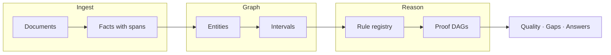

# Medical Memory

**Your health, reconstructed.**

[](https://www.typescriptlang.org/)
[](https://react.dev/)
[](https://vitejs.dev/)
[](./package.json)
[](./src/engine/versions.ts)

Medical Memory is a **provenance-first inference platform** for longitudinal health records. It is not a symptom checker, a diagnostic chatbot, or a PDF summarizer.

Every conclusion is a **proof object**: a directed acyclic graph from source character spans → premises → rules → one conclusion. If it cannot be traced to text in a document, it is not shown as fact.



---

## Why it exists

| Ordinary “health AI” | Medical Memory |
| -------------------- | -------------- |
| Model reads PDFs and paraphrases | Engine **re-reads exact spans** on every verification |
| One confidence score | **Source authority**, rule reliability, and explicit `notConcluded` |
| “Inconsistency” as a catch-all | **Contradictions** vs **data-quality warnings**, time-scoped by `asOf` |
| Black-box answers | **Receipt**: artifact id, engine version, verification score, model used |

---

## Quick start

```bash
git clone https://github.com/ritvik-m5/Medical-Intelligence-OS.git
cd Medical-Intelligence-OS
npm install
npm run dev          # http://localhost:5173 — opens on the Builder
```

**Try your own messy records** (optional):

```bash
npm run create:records   # writes sample .txt files to ~/Downloads/Medical records/
npm run dev              # Records → drop files → Extract and add to graph
```

| Command | Purpose |
| ------- | ------- |
| `npm test` | Full Vitest suite (engine, platform, builder, UI) |
| `npm run verify:pipeline` | Typecheck + tests + governance + meaning/AI audits |
| `npm run build` | Production build |

Optional local model (Ollama): `ollama pull llama3.2 && ollama serve` — then enable rewrite in Chat settings. The dev server proxies `/llm` so the browser stays same-origin.

---

## What you get in the app

| Area | Views |
| ---- | ----- |
| **Start** | Builder, Home, How it works, Chat, Reset |
| **Reconstruct** | Overview, Time Machine, Intervals, Health Graph |
| **Inspect** | Records, Measurements, Medical Debugger |
| **Reason** | Inference board, Ask, Research Mode, Research Lab |
| **Platform** | Record Quality, Cohort, FHIR export & redaction |

The **Time Machine** scrubber sets `asOf` for the whole workspace. Historical snapshots only include evidence **knowable on or before** that date — future documents cannot leak into the past.

---

## Repository layout

```
src/engine/     Pure TypeScript — ingest, graph, derive, verify, temporal eligibility
src/views/      React workspace (lazy-loaded)
src/builder/    Front door — real pipeline runs in the browser
src/ai/         Gateway: general chat · record · research (engine stays authoritative)
docs/           Audits, pipeline notes, full platform handbook
scripts/        Governance verify, sample records, mock LLM
```

The engine has **no React imports**. That boundary is intentional: the same core can run in a worker, CLI, or server.

---

## Documentation

| Document | Contents |
| -------- | -------- |
| [**Platform handbook**](./docs/HANDBOOK.md) | Full architecture, rules, builder, chat, research lab, limitations |
| [**Pipeline baseline audit**](./docs/pipeline-baseline-audit.md) | Data flow, temporal contract, verification commands |
| [**Product audit**](./docs/product-audit.md) | Per-view meaning and handoffs |
| [**Research accuracy audit**](./docs/research-mode-accuracy-audit.md) | Research Mode boundaries |

---

## Governance & quality gates

```bash
npm run verify              # version history, rule coverage, artifacts, reproducibility
npm run audit:nav           # sidebar ↔ router ↔ ViewId
npm run audit:meaning       # every view answers a real user question
npm run audit:ai-gateway    # routing, provenance, streaming
npm run audit:ai-validation # model claims cannot invent personal facts
```

CI runs **`npm run verify:pipeline`** on push to `main` (see [`.github/workflows/ci.yml`](./.github/workflows/ci.yml)).

---

## Safety & scope

Medical Memory **organises, explains, cites, and checks** imported text. It does **not** diagnose, prescribe, or replace clinical judgment.

- Not a medical device · not for clinical use  
- Synthetic demo patients only in shipped corpora  
- Local-first: corpus persists in the browser unless you export  

---

## License & access

Private repository. All rights reserved unless otherwise noted by the owner.

---

<p align="center">
  <sub>Engine <code>2.3.0</code> · Provenance verified at runtime · <a href="./docs/HANDBOOK.md">Read the handbook</a></sub>
</p>
